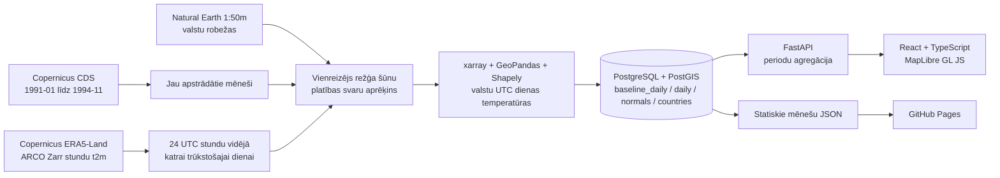

# Climate Atlas — arhitektūra un metodika

## Datu plūsma

## Avoti

- [Copernicus ERA5-Land ARCO](https://cds.climate.copernicus.eu/datasets/reanalysis-era5-land?tab=analysis_ready_data): oficiālais `sfc-2m-temperature/timeChunked.zarr` ar stundu 2 m temperatūru Kelvinos. Atļautais CDN piekļuves veids izmanto CDS API atslēgu. Vienas dienas aprēķinam tiek lasīti tikai 24 attiecīgās UTC stundas; pilnais reanalīzes arhīvs netiek lejupielādēts kā viens fails. Pārsūtīto fragmentu apjoms joprojām var būt liels, un [ARCO piekļuve ir beta stadijā](https://confluence.ecmwf.int/spaces/CKB/pages/639215345/Analysis+Ready+Cloud+Optimised+ARCO+Data).
- [Copernicus ERA5-Land post-processed daily statistics](https://cds.climate.copernicus.eu/datasets/derived-era5-land-daily-statistics?tab=overview): `2m_temperature`, `daily_mean`, `frequency=1_hourly`, `time_zone=utc+00:00`. Režģis 0,1° × 0,1°; nominālā izšķirtspēja ~9 km. Dienas produkts tiek aprēķināts pieprasījuma laikā CDS pusē; mūsu lietotnes pieprasījumos CDS netiek izmantots. Oficiālajā katalogā pašlaik norādīta aptuveni **6 dienu** publicēšanas nobīde.
- [CDS dienas statistikas metodika](https://confluence.ecmwf.int/pages/viewpage.action?pageId=505382218): UTC diennakts, stundu datu vidējā, NetCDF ZIP formāts.
- [Natural Earth 1:50m admin 0 valstis](https://github.com/nvkelso/natural-earth-vector/tree/master/geojson): kartes un aprēķinu robežu GeoJSON, ieskaitot Monako un Vatikānu. Šīs ir kartogrāfiskas robežas, nevis juridiski precīzs kadastrs.

## Valstu tvērums pirms datu ģenerēšanas

Katalogs `backend/country_catalog.json` un `public/countries.geojson` ir **iesaldēts 195 valstu saraksts**: [193 ANO dalībvalstis](https://research.un.org/en/unmembers) un [2 ANO novērotājvalstis](https://www.un.org/en/about-us/non-member-states) — Svētais Krēsls/Vatikāns (`VAT`) un Palestīna (`PSE`). Apstiprināto ISO kodu kopu glabā `config/un_country_codes.json`. Atlases skripts `scripts/build_country_catalog.py` salīdzina Natural Earth klasifikāciju ar šo kopu un apstājas, ja kāda valsts trūkst vai parādās papildu teritorija. Tajā normalizēti Natural Earth iekšējie kodi `PSX → PSE` un `SDS → SSD`. Atkarīgās teritorijas, Antarktīda, Taivāna, Kosova, Ziemeļkipra un Somālilenda nav šī ANO tvēruma atsevišķas valstis. Šis ir **atlases noteikums lietotnei**, nevis apgalvojums par strīdīgu teritoriju starptautiski tiesisko statusu.

Kartes vizuālais slānis `public/territories.geojson` atsevišķi rāda visas 47 pārējās Natural Earth admin-0 vienības, tostarp Grenlandi. To veido `python scripts/build_territories.py` no tā paša avota. Šis slānis ir neitrālā krāsā, nav klikšķināms un netiek izmantots PostGIS valstu temperatūras vai normas aprēķinos. Natural Earth klasifikācijas nosaukumi tiek saglabāti tikai datnē, nevis izmantoti kā apstiprināts valstu saraksts.

Kartes robežu katalogu var atkārtoti izveidot no [Natural Earth 1:50m valstu GeoJSON](https://github.com/nvkelso/natural-earth-vector/blob/master/geojson/ne_50m_admin_0_countries.geojson): lejupielādēt to kā `data/ne_original.geojson`, tad palaist `python scripts/build_country_catalog.py`. Skripts neizmaina iesaldēto atļauto valstu kopu un aptur ģenerēšanu, ja avota klasifikācija ar to nesakrīt.

Vienas valsts temperatūrā ietilpst **visi daudzstūri, kas šajā robežu datnē piešķirti tai pašai valstij**. Piemēram, Spānijas (`ESP`) ģeometrijā ir kontinenta daļa, **Kanāriju salas un Baleāru salas**; tās tiks iekļautas vienā Spānijas sauszemes platības svērtajā dienas temperatūrā un 1991–2020 normā. Atsevišķi klasificētas atkarīgās teritorijas netiek automātiski pieskaitītas citai valstij. Natural Earth 1:50m var izlaist pavisam mazas salas, tādēļ pirms zinātniskas publikācijas jāvalidē pilns salu un piekrastes pārklājums pret detalizētākām robežām.

## Vienreizējā sagatavošana

Vēsturiskā plūsma **pabeidzās 2026-10-30**. `backend/etl/arco_backfill.py` no PostGIS noteica pirmo trūkstošo dienu, caur `arco_2026.py` lasīja oficiālā ARCO Zarr 2 m temperatūras 24 stundas (00:00–23:00 UTC), aprēķināja režģa dienas vidējo, tad piemēroja kešotos valstu platības svarus. Dienas transakcija ierakstīja `baseline_daily` līdz 2020-12-31 un `daily` no 2020-01-01; 2020. gadā abas tabulas. Pabeigtās CDS dienas un 2026. gada ARCO dienas tika izlaistas. Pēc pilnas 188 valstu dienu pārbaudes aprēķināja `normals`, un `dataset_info.mode` tagad ir `era5_land`. `GlobalClimateARCOResume` ir tikai nepabeigta vēsturiskā darba atsākšanai pēc Windows pieteikšanās; tas nepapildina jaunas 2026. gada dienas. Vecais CDS uzdevums ir atspējots.

Vēsturiskā CDS plūsma zemāk apraksta jau saglabāto pirmo 47 mēnešu izcelsmi un alternatīvu gadījumam, ja ARCO nav pieejams.

1. Iepriekšējais CDS režīms `backend/etl/ingest.py --stream` pieprasīja vienu globālo mēnesi no CDS, to apstrādāja un pagaidu failu izmeta. DB tabulas `baseline_daily` un `ingested_months` glabā šī posma vēsturiskās valstu dienas un atsākšanas punktu. Ja arhīvi jau ir iegūti citādi, `backend/etl/download.py` glabā mēnešu NetCDF vai ZIP failus `data/raw/`; `ingest.py` spēj apstrādāt abus formātus. `download.py --recent-only` ir saglabāts kā vecās CDS plūsmas alternatīva, bet pašreizējā ikdienas plūsma lieto ARCO. Vajadzīga personīga CDS API atslēga un pieņemta datu kopas licence.
   Katra mēneša valstu dienas un ieraksts `ingested_months` tiek saglabāti vienā DB transakcijā. Apturot importu pēc žurnāla rindas `Ingested ... YYYY-MM`, šis mēnesis ir pilnībā saglabāts. Atkārtots `scripts/start_full_ingest.ps1` izlaiž pabeigtos mēnešus un atsāk ar nākamo. Režģa svaru kešs ir `data/weights-*.npz`; pagaidu NetCDF nav vajadzīgs atsākšanai.
   Ja CDS aprēķins ir pabeigts, bet NetCDF lejupielādi pārtrauc īslaicīga tīkla/SSL kļūda, lejupielādi atkārto no tā paša CDS rezultāta, neveidojot jaunu aprēķina pieprasījumu. Ja fails iegūts atsevišķi, `ingest.py --resume-raw --raw data/raw` ielādē tikai vēl nepabeigtos lokālos mēnešus esošajā `building` DB un saglabā tos tajos pašos kontrolpunktos.
   CDS dienas statistikas lietotne apstrādā **vienu mēnesi vienā pieprasījumā** ([Copernicus lietotnes dokumentācija, 2.4.3](https://dast.data.compute.cci2.ecmwf.int/documents/app-c3s-daily-era5-statistics/C3S_Application-Documentation_ERA5-daily-statistics-v2.pdf)). Tāpēc 2010–2020 dienas statistikas vienā CDS pieprasījumā nav derīgs šī produkta režīms. 2026. gada oktobra [ECMWF pakalpojuma norādījumi](https://forum.ecmwf.int/t/data-stores-service-protection-measures-affecting-data-downloads-and-account-access-cds-ads-ewds-ecds/15481) prasa derīgus secīgus pieprasījumus un iesaka izvairīties no lielām partijām. Tas neietekmē PostGIS shēmu vai valstu dienu aprēķinu.
2. `backend/etl/ingest.py` lasa vienu mēnesi pa dienām ar xarray. No 2 m temperatūras Kelvinos iegūst °C. Režģa garumus pārveido uz −180…180, lai sakristu ar robežām.
3. Vienreiz uz nemainīga režģa katrai valstij nosaka sauszemes šūnas, kuru temperatūra ir derīga. Katras šūnas un valsts daudzstūra pārklājumam nosaka ģeodēzisko platību. Pilnībā ietvertām šūnām izmanto visu šūnas platību; robežšūnām precīzu ģeometriju krustojumu. Režģa svarus glabā `data/weights-*.npz`; atslēgā ietilpst koordinātas, derīgo šūnu maska un robežu datne.
4. Katras valsts katras UTC dienas vidējais: `Σ(temperatūra_šūnā × pārklātā_platība) / Σ(pārklātā_platība)`. Tukšas/nederīgas šūnas neiekļauj. Sauszemes derīguma masku veido no ERA5-Land derīgajiem punktiem.
5. Visas 1991-01-01–2020-12-31 valstu dienu temperatūras paliek `baseline_daily(iso3,day,mmdd,temp_c)`; tā ir normas aprēķina pirmavota tabula, nevis tikai starprezultāts. No tās katram `MM-DD` izrēķina normu. **29. februāra normā ietilpst tikai astoņi garie gadi.** Dienu `MM-DD` savieno ar izvēlētā perioda katru dienu, tāpēc brīvi intervāli, nedēļas, gadi un DJF pāri gadu robežai lieto pareizās dienas normas. Šī vēsture ļaus vēlāk veidot rekordus, gada periodu ranžējumu un standartizētas anomālijas bez ERA5-Land režģu atkārtotas lejupielādes.
6. No 2020-01-01 valsts dienas vērtības glabā tabulā `daily`. 2020. gads ietilpst gan references periodā, gan lietotāja skatā; tas ir apzināti.

### Kvalitātes klases

| Statuss | Noteikums ETL skriptā | Attēlošana |
| --- | --- | --- |
| `grid` | vismaz 5 derīgas pārklājošas šūnas un ≥60% valsts platības pārklājums | parasta krāsa |
| `limited` | vismaz 1 pārklājoša šūna, bet zemāks pārklājums | krāsa + kvalitātes teksts |
| `proxy` | valsts platība ir <25% no vienas režģa šūnas platības, vai nav pārklājošas derīgas šūnas un tuvākā sauszemes šūna ir ≤100 km | krāsa + skaidra reģionālās aproksimācijas norāde |
| `unavailable` | nav derīgas šūnas vai pietiekami tuvas sauszemes aproksimācijas | neitrāla krāsa |

`proxy` nav precīzs valsts vidējais. Pašreizējā datubāzē tie ir Monako un Vatikāns; tiem vajadzīga atsevišķa zinātniska validācija. 7 salu valstis (`KIR`, `MDV`, `MHL`, `NRU`, `SYC`, `TON`, `TUV`) ir `unavailable`; saskaņā ar projekta lēmumu tām netiek ģenerēta downscaling vai cita aizvietotājvērtība. `coverage` un `grid_cells` glabājas DB, un API tos atgriež. Mazām valstīm un šīm septiņām salu valstīm kartē ir klikšķināmi punkti, jo daudzstūri globālā mērogā ir ļoti mazi.

### Perioda aprēķins

API `GET /api/anomalies?start=YYYY-MM-DD&end=YYYY-MM-DD` vienā vaicājumā savieno `temperature_archive` (1991–2019 no `baseline_daily`, 2020+ no `daily`) un nemainīto `normals` tabulu. Perioda faktiskā temperatūra ir valsts dienu aritmētiskais vidējais; perioda norma ir tieši šo dienu normu aritmētiskais vidējais; anomālija ir abu starpība. Karte visām valstīm izmanto vienu simetrisku skalu **−6…+6 °C** ar piesātinājumu ārpus diapazona. Šī ir katras valsts, nevis pasaules platības svērta anomālija. Kreisās joslas “valstu vidējā” ir vienkāršs valstu vidējais un nav globālās sauszemes anomālijas novērtējums.

Nokrišņu skatam tie paši API galapunkti pieņem `metric=precipitation`. `precipitation_archive` dienu vērtības un attiecīgās `precipitation_normals` normas izvēlētajā periodā **summē** milimetros. Novirze ir `(faktiskā summa / normas summa − 1) × 100 %`; kartes brūnā–zilā skala piesātinās pie −100 % un +100 %. Pie ļoti mazas dienas normas procentuālā novirze var būt liela, tāpēc valsts profilā vienmēr redzamas arī abas summas milimetros. Kreisajā joslā ir 188 valstu procentuālo noviržu mediāna. Temperatūras pieprasījumi bez `metric` parametra saglabā iepriekšējo aprēķinu. Statiskajā vietnē šo pašu aprēķinu veic `src/dataClient.ts` no `public/data/precipitation/` mēnešu failiem.

Meteoroloģiskās sezonas: MAM=1.03–31.05, JJA=1.06–31.08, SON=1.09–30.11, **DJF N = iepriekšējā gada 1.12 – N gada 28./29.02**. DJF 1991 nav pieejams, jo lietotāja periods sākas 1991-01-01.

## Glabāšana un ātrdarbība

`baseline_daily(iso3,day)`, `daily(iso3,day)` un `normals(iso3,mmdd)` primārās atslēgas ir piemērotas vēstures, perioda un valsts vaicājumiem; vēstures tabulai ir arī `(iso3,mmdd)` un `day` indeksi. Kartes krāsas atjaunojas ar MapLibre `feature-state`, nemainot 3 MB GeoJSON katrā pieprasījumā. `countries.geom` ir PostGIS `MultiPolygon(4326)` ar GiST indeksu. API neielādē režģa failus. Ikdienas `backend/etl/arco_daily_update.py` pārbauda PostGIS dienu nepārtrauktību, ARCO pēdējo pilno UTC dienu, 24 stundas un 188 valstu vērtības pirms katras dienas transakcijas. Datu bāze ir atsākšanas kontrolpunkts, un gads kodā nav ierobežots. `GlobalClimateDailyUpdate` katru dienu plkst. 08.00 atjauno arī statisko eksportu un būvējumu; skatīt [AUTOMATION.md](AUTOMATION.md). Vēsturiskā 1991–2020 datubāze un normas jāatjauno tikai tad, ja tiek pieņemts lēmums pārrēķināt labotas avota dienas.

## GitHub Pages ceļš

`backend/export_static.py` eksportē normu tabulu un mēnešu JSON no sagatavotās DB. `src/dataClient.ts` ar `VITE_STATIC_DATA=1` veic perioda aprēķinu pārlūkā no šiem failiem. Vite `GITHUB_PAGES=1` nosaka bāzes ceļu no `GITHUB_REPOSITORY` vai izvēles `PAGES_BASE`. Statiskā izlaidumā nav vajadzīgs FastAPI vai PostgreSQL, bet **datu atjaunināšanai** joprojām vajadzīgs lokālais ARCO/ETL darbs, kas ģenerē JSON. `.github/workflows/pages.yml` tiek palaista tikai manuāli; lokālais ikdienas uzdevums GitHub nepublicē. GitHub Pages nevar pats izpildīt Python ETL vai PostGIS. Pašreizējā lokālā vietne izmanto dzīvu FastAPI/PostGIS savienojumu. Vēlākai dzīva servera versijai vajadzēs atsevišķu API un PostgreSQL izvietojumu.

## Drošas interpretācijas robežas

- ERA5-Land ir reanalīze, nevis tieši staciju novērojumi. Aptuveni 9 km režģis nevar atšķirt mikroklimatu mikrovalstīs.
- Valsts sauszemes vidējais var būt jutīgs pret robežām, piekrasti, salām un reljefu. `limited`/`proxy` rezultāti jāinterpretē kopā ar kvalitātes statusu.
- Demonstrācijas režīma skaitļi ir deterministiski **sintētiski**. Tie nav ERA5-Land dati un nav izmantojami klimata secinājumiem. Reālais režīms glabājas atsevišķā DB failā vai PostgreSQL datubāzē.
